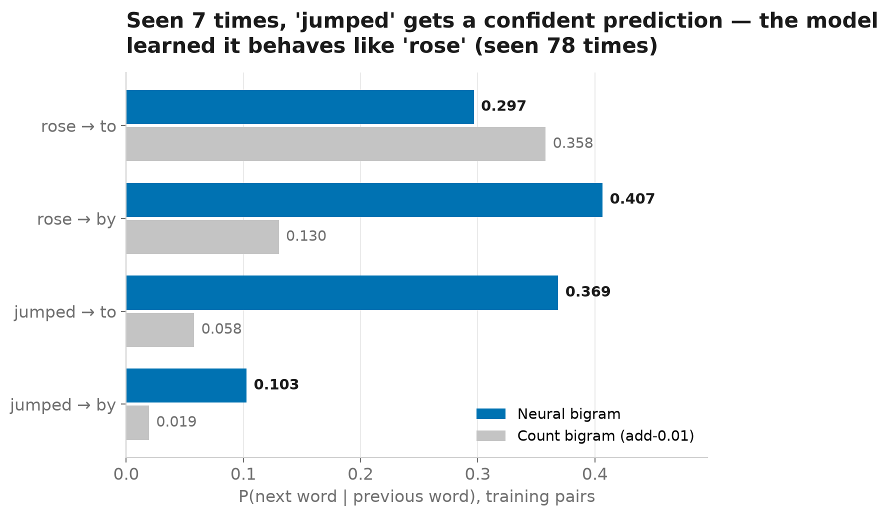
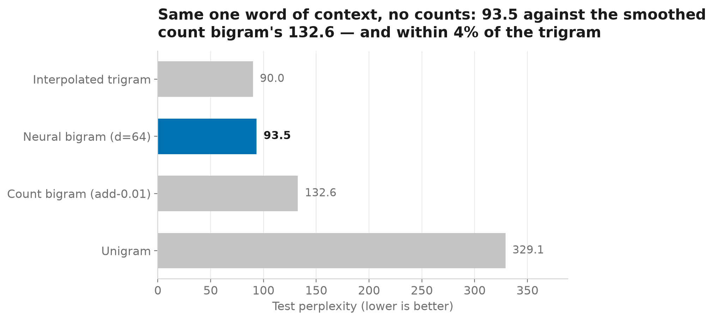
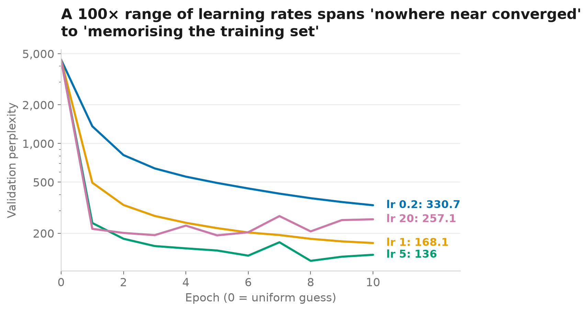
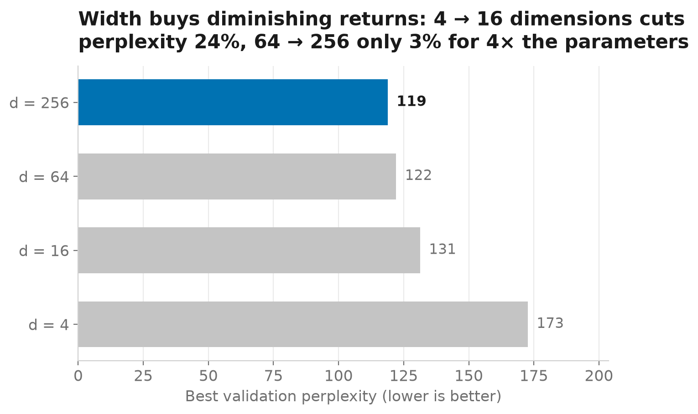

# Part 3 — Language Modeling

> Part 3 of **[Tokens to Agents](../../README.md)** — building the path from classical language models to modern AI agents from first principles.
>
> 📖 `Article — coming soon`

**A neural next-token model with every gradient written by hand. One word of context, and it nearly catches Part 1's trigram.**

The word *jumped* appears seven times in training. Part 1's count-based bigram hedges on what follows it; this model says *to* with probability 0.37, because it learned on its own that *jumped* behaves like *rose* and borrowed *rose*'s seventy-eight sightings. That borrowing is the whole story: 580,000 learned numbers standing in for a 20-million-cell table, with no smoothing parameter anywhere.



The model is an embedding table, one linear layer and a softmax, trained in pure NumPy with no autograd. Forward pass, cross-entropy gradient and SGD update are written out and checked against finite differences before anything is trained.

## Results

86,587 training pairs · 10,000 validation · 24,038 test · vocabulary 4,495 (Part 1's closure, Part 1's split)

| Model | Context | Test perplexity |
| --- | --- | ---: |
| Unigram | none | 329.1 |
| Count bigram (add-0.01, best α) | 1 word | 132.6 |
| **Neural bigram** (d=64, lr 5, 10 epochs, SGD) | 1 word | **93.5** |
| Interpolated trigram (best weights) | 2 words | 90.0 |

The two bigram rows see identical input. One counts, one learns; learning is 29% better and lands within 4% of a model that gets an extra word of context.



What the sweeps taught:

- **Training loss is not the objective.** At learning rate 20 the model reaches the *lowest* training loss of the sweep and the second-worst validation perplexity: it memorises the training pairs. The chosen rate (5) was selected on held-out data, never on the number the optimiser sees.
- **A few dimensions do most of the work.** Four numbers per word already works; 16 is 24% better, 64 another 7%, and 256 buys 3% more for four times the parameters. The width *is* the smoothing.
- **The gradients are right, provably.** Finite differences agree with the analytic gradients to a relative error of 4.1 × 10⁻⁹, and the code reproduces a hand-worked SGD step digit for digit.





## What's inside

```text
lm/
├── data.py      # Part 1's vocabulary closure; (previous, next) integer pairs
├── model.py     # forward, loss, backward, SGD — the gradients, written out
├── check.py     # finite-difference gradient check
└── train.py     # mini-batch SGD with per-epoch validation perplexity

run.py           # reproduces every number and figure; writes results.json and params.npz
notebook.ipynb   # the same experiment as narrative, one hand-worked step first
results.json     # every published number, machine-checkable
```

The model in `model.py`:

```text
h = E[x]           embedding of the previous token
z = W h + b        one logit per vocabulary word
p = softmax(z)
L = −log p[y]

∂L/∂z = p − onehot(y)                 the only derivative that carries anything
∂L/∂W = ∂zᵀ h    ∂L/∂b = ∂z    ∂L/∂E[x] = Wᵀ ∂z
```

No autograd, no framework: `numpy` and a dataclass.

## Reproduce

```bash
# from the repository root
uv sync
uv run python parts/03-language-modeling/run.py
```

Runs the gradient check, the learning-rate sweep (0.2 → 20), the width sweep (d = 4 → 256) and the final model; figures land in `assets/images/`, numbers in `results.json`, trained weights in `params.npz`. Roughly ten minutes on an idle laptop — the sweeps dominate. The environment is pinned by the repository's `uv.lock` and `.python-version`.

## Data

Same corpus, split and vocabulary closure as Part 1: [Financial PhraseBank](https://huggingface.co/datasets/takala/financial_phrasebank) (Malo et al., 2014), `Sentences_50Agree`, downloaded on first use and cached (CC BY-NC-SA 3.0, never redistributed here). Hyperparameters are chosen on a 10% validation slice of the training sentences; the 970 test sentences are scored once, so every perplexity here is directly comparable with Part 1's table.

## References

- Yoshua Bengio, Réjean Ducharme, Pascal Vincent & Christian Jauvin — [A Neural Probabilistic Language Model](https://www.jmlr.org/papers/v3/bengio03a.html), JMLR 2003 — the feed-forward neural language model; this part is its one-word-of-context form.
- Daniel Jurafsky & James H. Martin — [*Speech and Language Processing*](https://web.stanford.edu/~jurafsky/slp3/), 3rd ed. draft (2026), [Chapter 7: Neural Networks](https://web.stanford.edu/~jurafsky/slp3/7.pdf) — the cross-entropy gradient and backpropagation as derived here.
- Pekka Malo et al. — [Good Debt or Bad Debt](https://arxiv.org/abs/1307.5336), 2014 — the Financial PhraseBank corpus.

## Next: Part 4 — Transformers

This model reads one word and forgets the rest. Part 4 replaces the single lookup with attention — every position reading every other — built from the same parts: an embedding table, matrix products, a softmax.

---

**[← Part 2 — Embeddings](../02-embeddings)** · **[Tokens to Agents](../../README.md)** · **Next: Part 4 — Transformers →**
